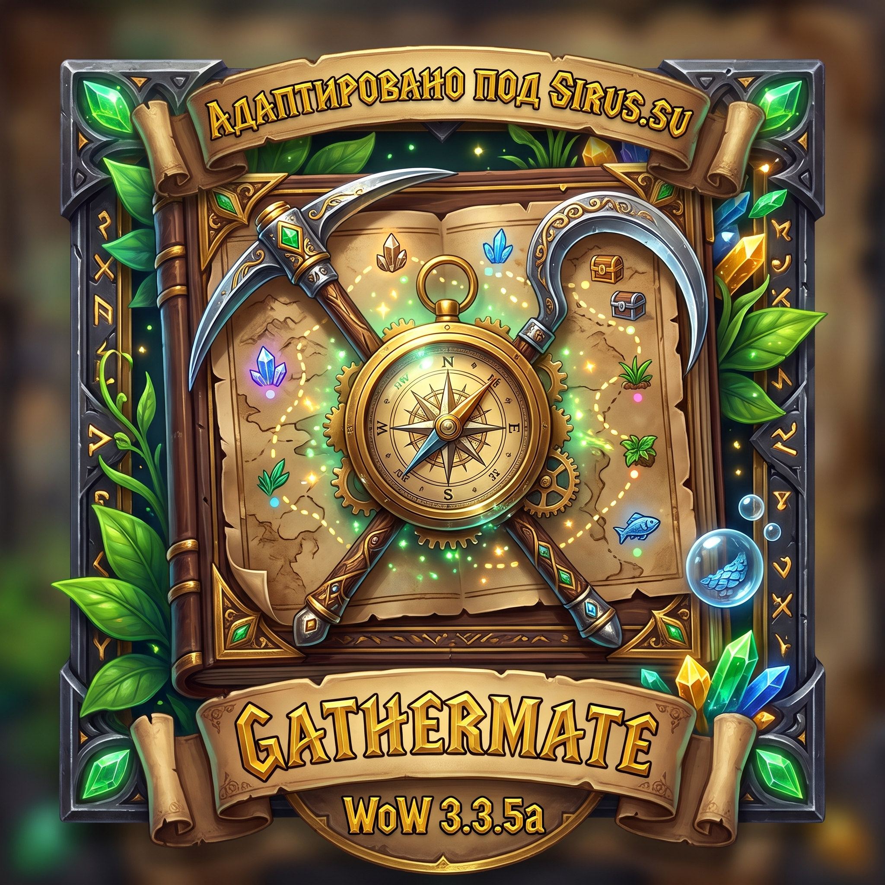
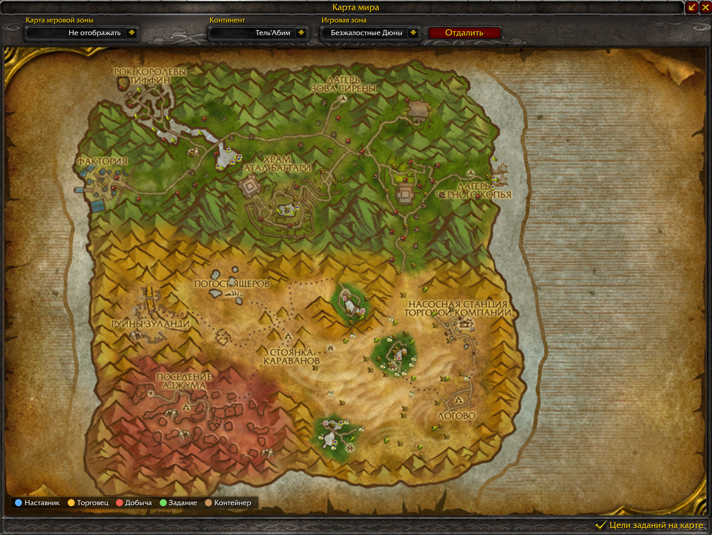

  

  # 🌿 GatherMate + GatherMate_Data (WoW Sirus 3.3.5a)

  -blue)
  
  
  

Адаптированная версия **GatherMate** вместе с полной базой данных **GatherMate_Data** специально под актуальный клиент **WoW Sirus (3.3.5a)**.

В стандартной версии GatherMate отсутствуют размеры и ID кастомных карт Сируса, из-за чего на новых островах (Тель'Абим, Тол'Гарод и др.) собранные ресурсы удаляли друг друга при сборе, а иконки прилипали к центру миникарты. В этой сборке проблема полностью исправлена, добавлена база ресурсов Тель'Абима и поддержка автообновления через **Sirus Launcher**.

## 📸 Скриншот в игре (Остров Тель'Абим)

## ✨ Что изменено и добавлено в сборке под Sirus (v1.23)

* **Поддержка всех кастомных локаций и островов WoW Sirus** (точные размеры в ярдах перенесены из официальной библиотеки `Astrolabe-0.4-Sirus`):
  * 🦊 **Тель'Абим** (`TelAbim`)
  * ⚔️ **Тол'Гарод** (`TolGarod`)
  * 🏝️ **Затерянный остров** (`LostIsland`), **Мангровый остров** (`MangroveIsland`), **Поднявшиеся глубины** (`RisingDepths`), **Андраккис** (`Andrakkis`)
  * 🌲 **Нордерон** (`Norderon`), **Гилнеас** (`GilneasCity` и `GilneasSilverpineForest`), **Классический Хиджал** (`ClassicMountHyjal`)
  * 👑 **Остров Форбс** (`VIP`) и **Остров Погоды** (`PRIME`)
  * ❄️ **Фельярд** (все 11 локаций континента `Felyard`)
* **Готовая база ресурсов Тель'Абима в `GatherMate_Data`:** в базу импорта добавлены **178 точек** стартового острова вульпер Тель'Абим (155 точек трав, 19 косяков рыбы, сундуки и руда).
* **Поддержка автообновления через Sirus Launcher:** в `.toc`-файлы обоих модулей прописаны заголовки `X-Sirus-Update`, благодаря чему лаунчер Сируса автоматически проверяет и загружает свежие обновления базы и кода.
* **Страховочный фоллбэк (Fallback-система):** если в будущих обновлениях Сируса появится новая карта, аддон автоматически назначит ей безопасные координаты и уникальный ID, чтобы точки не затирали друг друга.
* **Исправление миникарты и карты мира (`Display.lua`):** корректное определение текущих координат игрока и ID зоны на кастомных континентах Сируса.
* **Исправление русской локализации (`GatherMate-ruRU.lua`):** исправлены опечатки перевода 2009 года, из-за которых клиент 3.3.5a не записывал часть рудных жил и сундуков (*Огневитовая жила, Покрытая слизью серебряная жила, Подбитый сундук, Огнешляпка, Росток кровоцвета, Куча земли Ун'Горо, Плетеный ларец, Обломок вечной мерзлоты* и др.).
* **Исправление битых текстур (`Constants.lua`):** устранены опечатки оригинального аддона в путях к иконкам сундуков (`chest.tga` и `treasure.tga`), вызывавшие зелёные квадраты на карте.

## 📥 Установка и автообновление

1. Скачайте готовый архив **`GatherMate_Sirus_v1.23.zip`** из раздела **[Releases](../../releases/latest)**.
2. Распакуйте папки **`GatherMate`** и **`GatherMate_Data`** в папку вашего клиента игры:
   `World of Warcraft Sirus\Interface\AddOns\`
3. В меню выбора персонажа нажмите кнопку **«Модификации»** и убедитесь, что галочки стоят напротив `GatherMate` и `GatherMate_Data`.
4. В дальнейшем обновлять аддон и базу данных можно в один клик прямо через **Sirus Launcher** (раздел «Аддоны»).

## 🗄️ Как подключить базу данных (GatherMate_Data)

После первого входа в игру база данных не активируется автоматически — её нужно один раз импортировать:

1. Введите в чат команду `/gathermate` (или откройте **ESC → Интерфейс → Модификации → GatherMate**).
2. Перейдите во вкладку **«Импорт данных» (Import Data) → GatherMateData**.
3. В списке **«Базы для импортирования»** отметьте галочками нужные профессии (*Травничество, Горное дело, Рыбная ловля, Газовые облака, Сокровища*).
4. Выберите вид импорта **«Слить» (Merge)** и нажмите кнопку **«Импортировать GatherMateData»**.
5. **Важно:** сразу после импорта введите в чат команду `/reload`, чтобы клиент принудительно сохранил базу на диск в папку `WTF` (иначе при внезапном вылете игры или закрытии через `Alt + F4` импорт сбросится).

## 📂 Изменённые файлы

* `GatherMate/Constants.lua` — таблица размеров и ID кастомных карт Sirus, фоллбэк неизвестных зон, фикс путей текстур.
* `GatherMate/Display.lua` — корректная обработка миникарты и карты мира на кастомных континентах.
* `GatherMate/Locales/GatherMate-ruRU.lua` — точное соответствие названий объектов сбора русскому клиенту 3.3.5a / Sirus.
* `GatherMate/GatherMate.toc` и `GatherMate_Data/GatherMate_Data.toc` — версия `1.23`, ревизия базы `275` и привязка к Sirus Launcher (`X-Sirus-Update`).
* `GatherMate_Data/HerbalismData.lua`, `FishData.lua`, `TreasureData.lua`, `MiningData.lua` — добавлены координаты ресурсов острова Тель'Абим (`[167]`).